# 奶蛙 3D 作者模型

本目录是按用户提供的 [正、侧、背设计图](reference.png) 制作的 Blender 建模初版。黄色连续头身、奶油肚皮、绿色眼睛、橄榄色手脚；没有耳朵和尾巴。本版重点调整内收的短圆手指与连续掌根，手指和身体属于同一个封闭网格。每侧手臂有两段内侧肩根、十二段自由弯曲骨骼，手掌转向逐段传递，避免只旋转手腕。手臂末端切线与掌心对齐，招手增加肩胸预备、头部跟随和独立手指动作。已有坐姿键鼠动作接入桌宠；输入中断与睡眠退出采用平滑混合。

- [naiwa.blend](naiwa.blend)：可编辑源工程，含角色、80 根骨骼、形态键、8 段动画和摄影棚。
- [naiwa.glb](naiwa.glb)：角色、蒙皮、材质、表情与动画，供独立预览和版本 2 模型库导入。
- [validation.json](validation.json)：使用项目现有 Three.js 重新加载导出文件的检查结果。
- [奶蛙 3D 模型包](../../model-store/naiwa-3d.kurocat.json)：在模型库导入并使用，启用奶蛙专用骨架适配与猫咪共用的实时交互控制。
- [制作与骨架说明](../../docs/naiwa-3d-design.md)：骨骼命名、IK 操作、表情控制、复现脚本及后续接入步骤。

已有开发服务中打开 `/naiwa3d.html`，可以体验真实桌宠的视线跟随、输入、道具和小动作，切换键盘配列、暂停及旋转视角，并展开参考图。使用项目现有开发依赖即可，直接双击 HTML 无法加载 TypeScript。2D 动作预览为 `/harness.html?breed=builtin-naiwa&idle=0`。

## 造型预览

以下是作者工程的历史渲染图。Blender 第 0 帧保留自然站姿，从第 1 帧播放作者动画；当前 HTML 与桌宠默认坐姿，并实时解算手掌接触、视线和情绪。

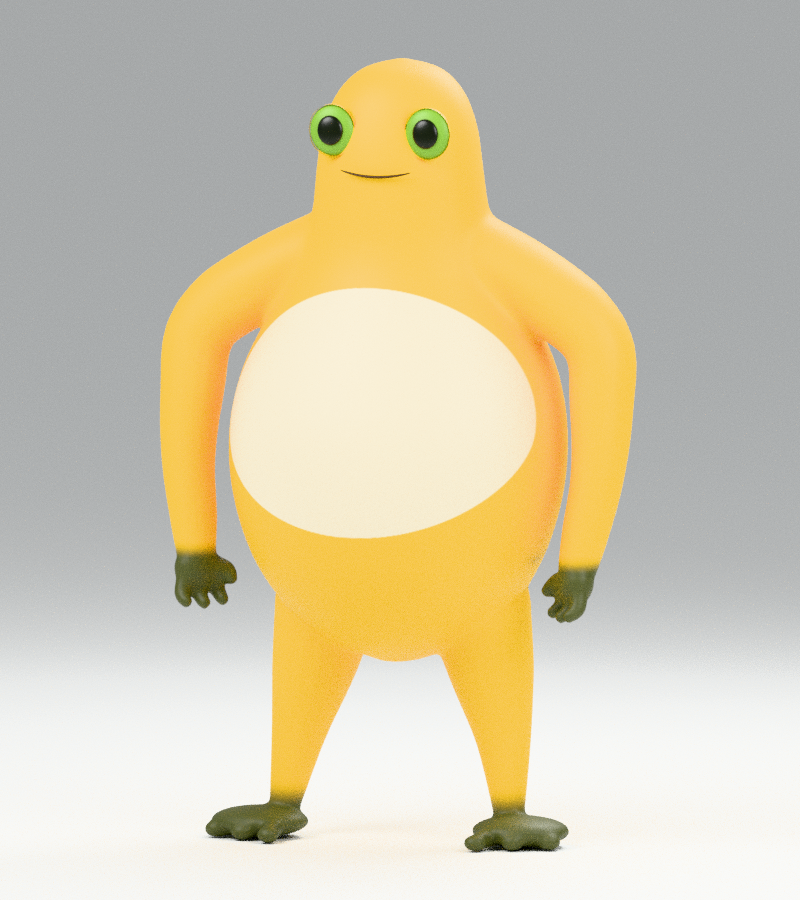

| 正面 | 侧面 | 背面 |
| --- | --- | --- |
| 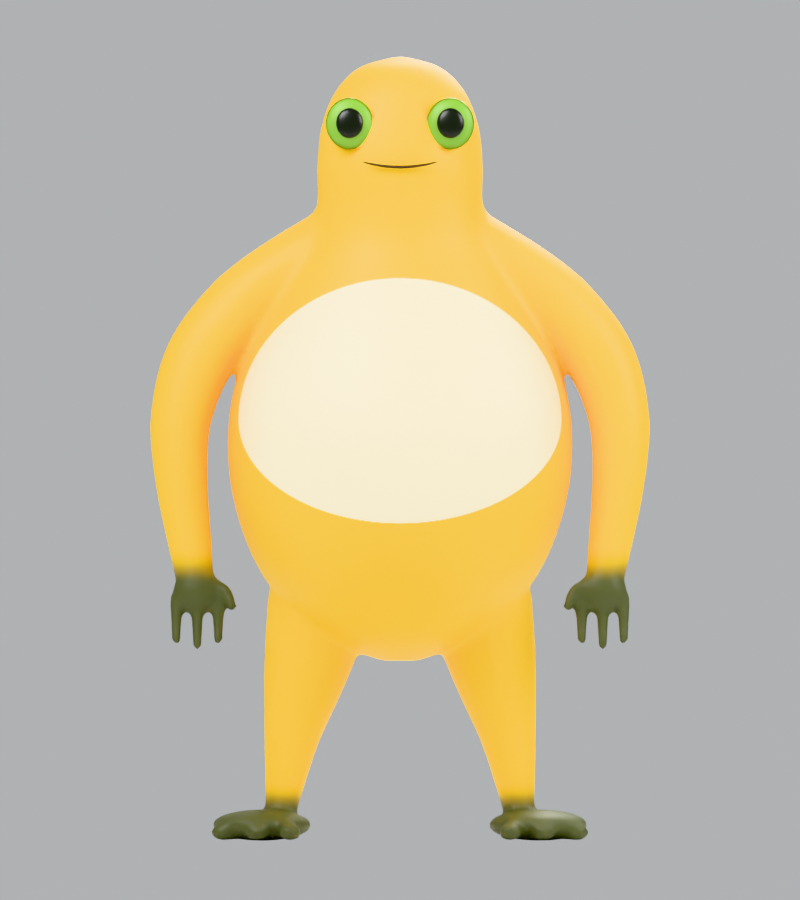 | 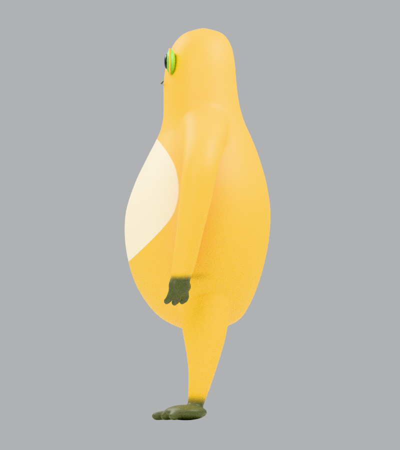 | 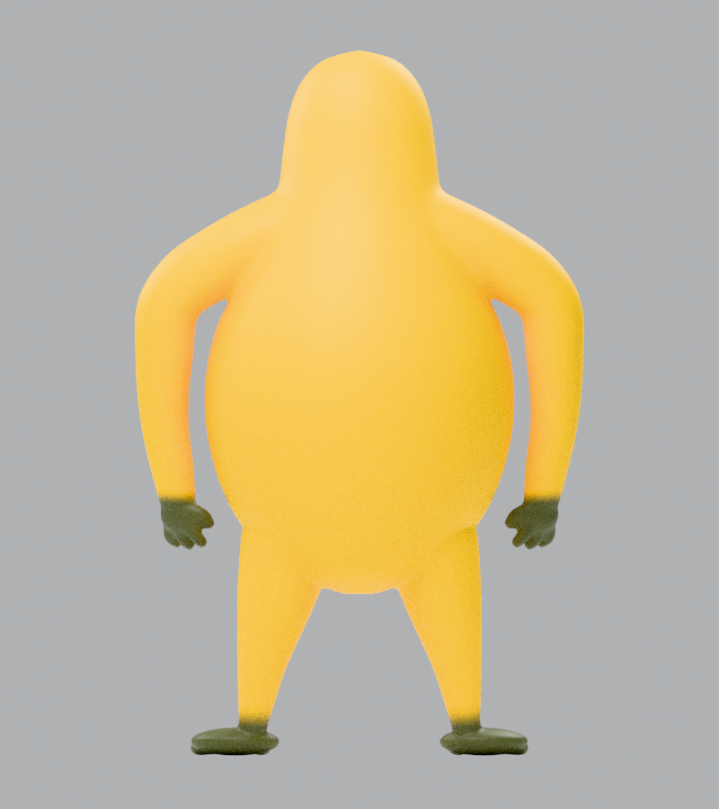 |

| 坐姿呼吸 | 使用鼠标 | 招手 |
| --- | --- | --- |
| 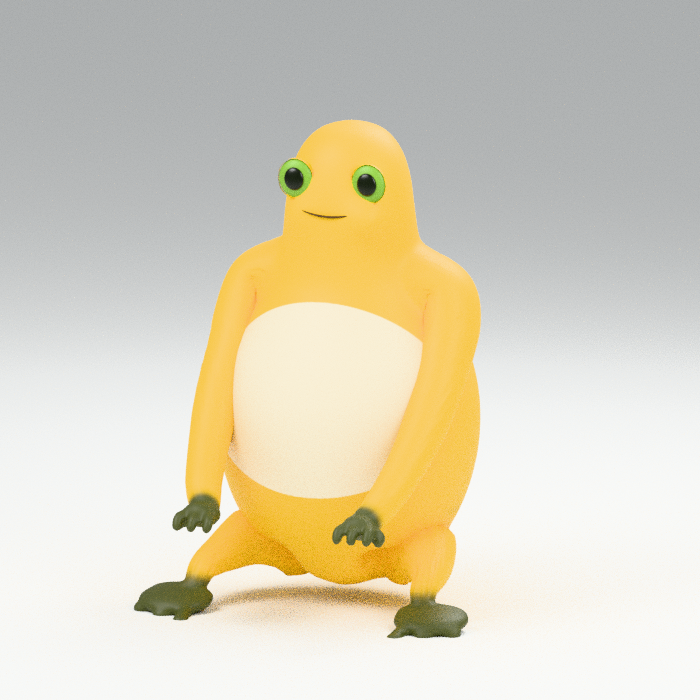 | 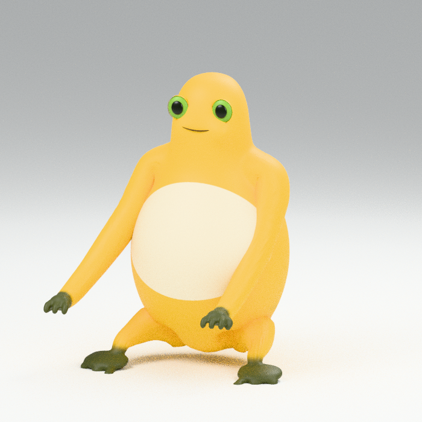 | 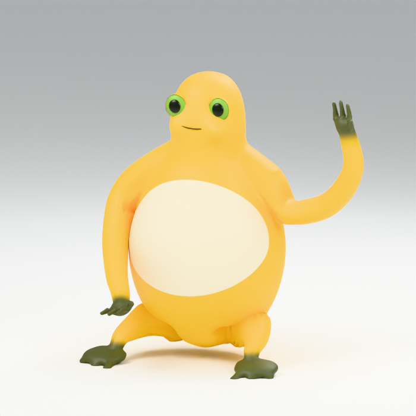 |

| 坐着打盹与流口水 | 历史作者动画：鼓腮与跺脚（当前 3D 运行时禁用鼓腮） |
| --- | --- |
| 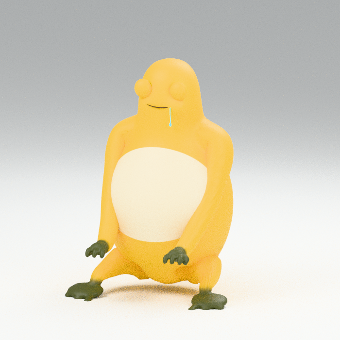 | 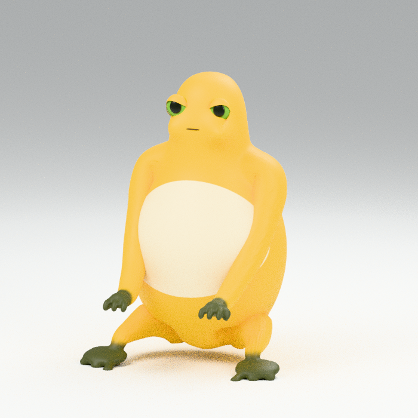 |

## 手部与连续动作

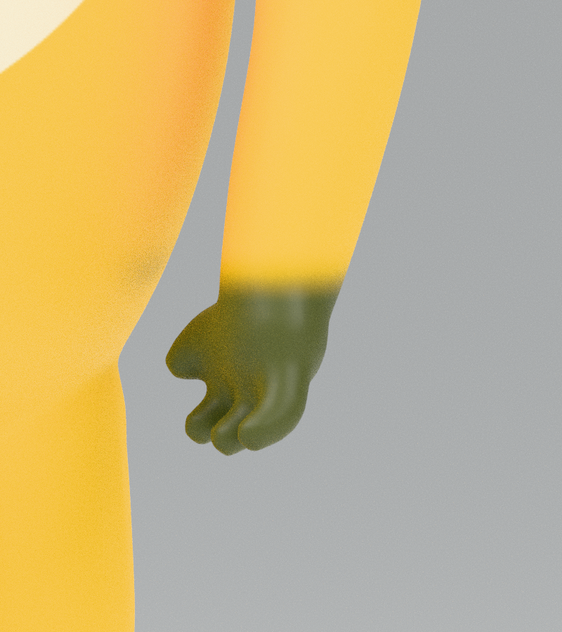

[播放 8 秒动作视频](previews/gesture.mp4) · [十二帧动作分解](previews/gesture-sheet.jpg)

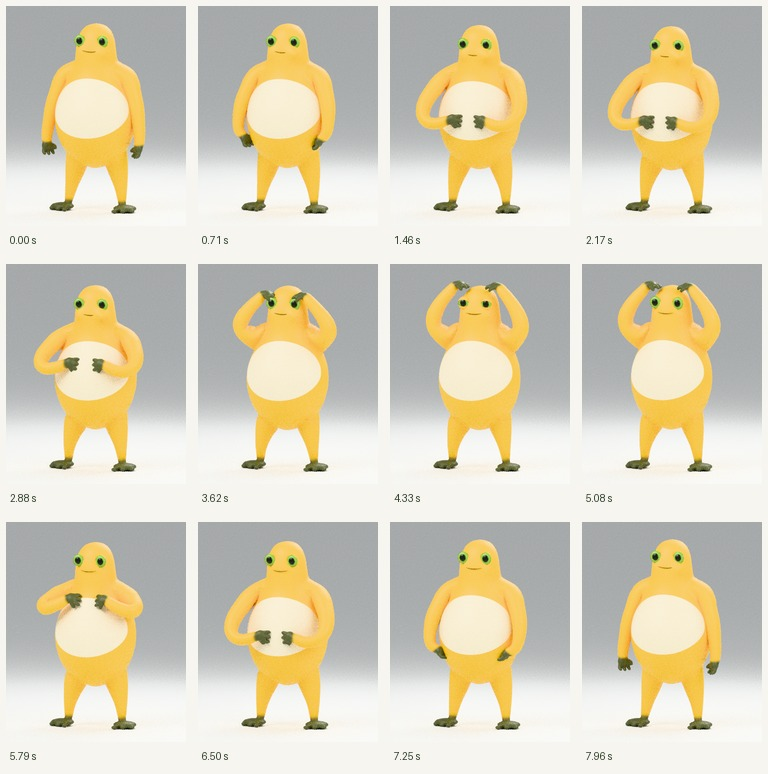

这段作者动画参考用户视频中的扶肚、抬臂和摸头，展示站姿到扶腹、触头再回位的手臂衔接。视频中的大笑口型尚未复刻；当前桌宠打滚来自共用动作控制。HTML 保留视频播放，检查作者片段中间姿态请在 Blender 中拖动时间轴。

## 导出复查

以下三张图来自新场景重新导入 GLB 后的渲染，用于核对导出后的蒙皮、表情和动画。不是用源工程截图替代导出结果。

| GLB 睡觉 | GLB 招手 | GLB 摸头 |
| --- | --- | --- |
| 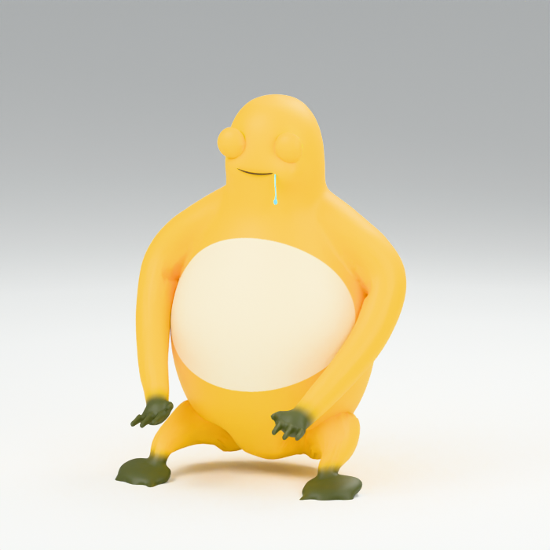 | 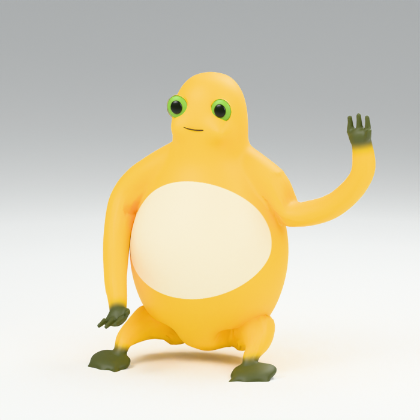 | 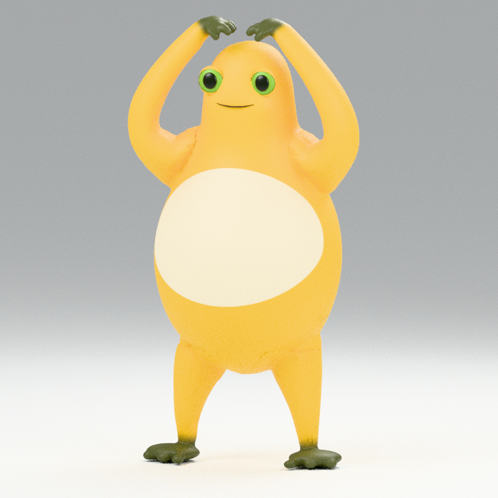 |

作者片段包含 `idle`、`typing`、`mouse`、`sway`、`wave`、`nap`、`angry`、`delight`，可在 Blender 查看。当前 HTML 使用桌宠控制器，其交互动作不等于逐一播放这些片段；静态图只能展示一个时间点。

## 当前边界

这是可编辑的造型与骨架基础，肩部、手指、接触和参考图还原度仍可继续精修。当前网格是作者密度，尚未完成移动端减面和帧率测试。内置奶蛙是 2D，3D 作为独立模型导入；版本 2 包或通过完整校验的裸 GLB 均可启用专用适配器。现已接入实时键鼠、五种道具、伸舌按键、跺脚、视线、情绪、坐睡和协调打滚；招手带动肩胸与手指，新增无声吸鼻涕，所有 3D 情绪下禁用鼓腮；趴下睡觉尚未制作。不能仅修改旧 2D 包的适配器名称获得 3D 模型。

参考图和角色设计权利归原权利人。将参考图随作者文件保存是为了模型对照，不表示授予原设计或参考图的额外版权许可。
